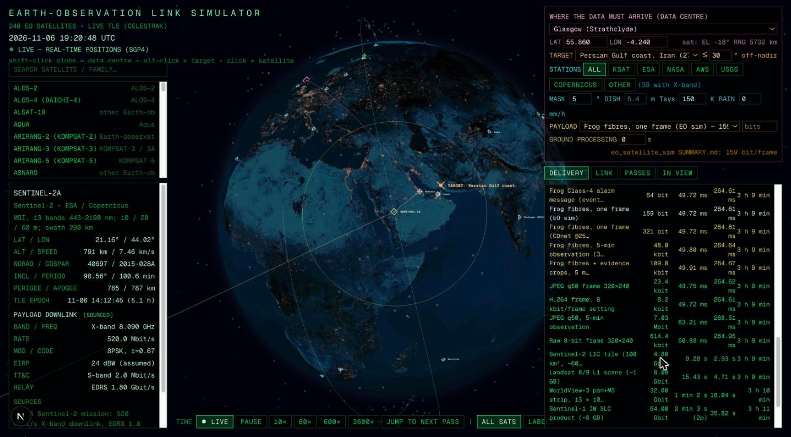

# EO Link Simulator — real satellites, real stations, and what it costs to deliver a semantic message



A Next.js / three.js application that answers one question with real data: *if a frog-retina front end on an
Earth-observation satellite produces a semantic message now, when does it reach my data centre, through what, and
with what noise and margin?*

```bash
npm install
npm run dev          # http://localhost:3088
```

## What is real and what is modelled

| item | source | status |
|---|---|---|
| Satellite positions | CelesTrak GP elements (`GROUP=resource`, the Earth-resources fleet, plus ICEYE, Capella, Suomi NPP, NOAA-20/21 and eight Planet SuperDoves), propagated with SGP4 (`satellite.js`) every frame; server route caches 6 h, bundled snapshot as fallback | **real** — cross-checked against the independent `sgp4` Python package: agreement within 0.06° (`docs` of this README) |
| Which satellites are Earth observation | CelesTrak's own classification | real |
| Downlink band, frequency, data rate, modulation | per-satellite catalogue in `lib/catalog.ts`, each entry tagged **sourced** (operator / engineering source), **typical** (eoPortal, trade press) or **assumed** (class default) and listing its sources | real where tagged sourced |
| Satellite EIRP, ground G/T | typical engineering values; **always labelled assumed**; dish size and system temperature are editable | modelled |
| Ground stations | 45 real sites (KSAT, ESA ESTRACK, NASA NEN, AWS Ground Station, USGS, CSA, ISRO, JAXA, CRESDA, INPE, CONAE, CNES; EDRS/TDRS/JDRS gateways), coordinates from the operators (±0.05°) | real |
| GEO relays | EDRS-A 9°E, EDRS-C 31°E, TDRS East/West/Z, JDRS-1; line of sight computed geometrically from the LEO position | real slots, availability modelled |
| Pass prediction | 48 h, 20 s scan, AOS/LOS refined by bisection to <1 s, any elevation mask | computed |
| Link budget | FSPL, ITU-R P.676 gaseous absorption, ITU-R P.838 rain, pointing/polarisation/implementation losses, kT noise, Eb/N0 vs CCSDS required Eb/N0, Shannon capacity, uncoded QPSK BER and a coded-BER waterfall model, Doppler from range-rate | textbook formulas, assumptions printed |
| Delivery time | wait for next contact (multi-pass drain for large files) + propagation + serialisation (one CCSDS AOS frame minimum) + terrestrial fibre (great circle × 1.5 at 2c/3) + optional processing; three routes: direct to the station network, GEO relay, own antenna at the data centre | computed |
| On-board queue and duty cycle | recorder backlog ahead of the payload (default: mission daily volume / 16, i.e. ~1.5 h of acquisition; FIFO or priority), X-band transmitter cap per orbit (Sentinel-1: 30 min), ground-processing presets (raw / NRT 1 h / standard 24 h); a fourth route sends the message on the S-band TT&C channel through every S-band station | sourced volumes where known, see `docs/LATENCY_RESEARCH.md` |
| Payload sizes | frog link, JPEG, H.264 and raw figures measured in this project (`eo_satellite_sim`, E8); full-product sizes from the operators | measured / sourced |

## Using it

1. **Pick a satellite** (list on the left, searchable by name or family, or click it on the globe). The card shows
   its orbit, its sensor, its downlink (band, frequency, rate, modulation, EIRP), relay capability and sources.
2. **Pick where the data must arrive**: a data centre from the list, typed coordinates, or shift-click on the globe.
3. Optionally **pick a target** (where the event happens) and the maximum off-nadir angle: the message is then
   assumed to be created at the next imaging opportunity rather than now.
4. Choose the **station network** (all / KSAT / ESA / NASA / AWS / USGS / Copernicus / other), elevation mask, dish,
   system temperature and rain.
5. Choose the **payload** (frog alarm 64 bit … Sentinel-1 SLC 64 Gbit) or type a bit count.

**Download PDF report** (button beside the tabs) writes a 6–8 page report from the live state: globe snapshot, satellite card with TLE and sources, the communication path diagram and timeline bar for every route with each latency term, the payload on the radio, the full link budget and noise table with the formula for every line, the 48 h contact table, target opportunities and relay windows, the same routes for every payload, and the methods, assumptions, station list and verification links. A sample is in `docs/sample_report_sentinel2a_glasgow.pdf`.

Tabs: **delivery** (the three routes with every time term), **link** (the full budget now, or at the best geometry of
the next pass), **passes** (48 h contact table, data-centre passes, target opportunities, relay windows; ▶ jumps the
clock there), **in view** (stations seeing the satellite now, relay state, the station list with sources).

Globe: satellites (cyan squares; selected = yellow diamond with its footprint at the mask and its ground track),
stations (cyan circles; white when in view; links to the selected satellite, the receiving link brighter),
data centre (magenta diamond, fibre arc from the receiving station), target (orange cross), GEO relays (yellow
squares at 6.6 Earth radii; line drawn when in line of sight).

## Why real missions quote hours

`docs/LATENCY_RESEARCH.md` collects the operator figures: ~10 min of contact per 100-min orbit, 4–6 windows a day
per station, 0.5–1.5 TB/day into the recorder, transmitter duty-cycle caps, and timeliness policies (Sentinel NRT
1–3 h, standard 24 h; Landsat ~5 h; Planet 2–4 h; ICEYE ~15 min when streaming; VIIRS fires < 60 s by direct
broadcast). The simulator models the recorder queue, the duty cap, the processing time and a telemetry-channel
route so the semantic payload can be compared against imagery on the same footing.

`docs/PRIORITY_MECHANISMS.md` answers whether a satellite can send one message ahead of its queue: yes, through
recorder priority (Sentinel-2 NRT head-of-queue, real-time pass-through), CCSDS virtual-channel priority, DTN
bundle classes, and always-on channels (EDRS, TDRS Demand Access, Iridium SBD, BeiDou, Inmarsat, Kepler). The
simulator's fifth route uses the Iridium short-burst figures (5–20 s per message).

`docs/QUEUE_ESTIMATE.md` explains how the recorder queue of Sentinel-2A/B/C is estimated from ESA's published
acquisition plan (route `/api/s2plan`, library `lib/queue.ts`): datatakes × 490 Mbit/s in, 560 Mbit/s out over the
core stations and 1.8 Gbit/s on EDRS, shown as a 48 h sparkline under the backlog field.

## What the numbers say for the frog link

A frog message is 64–321 bits. At 520 Mbit/s it serialises in under a microsecond and even the one-frame CCSDS
minimum is 17 µs; propagation is 3–8 ms; fibre to a data centre on another continent is 30–60 ms. **Everything else
is waiting**: without a relay a sun-synchronous satellite waits up to ~95 min for a pass over a global network
(longer for one network), and the pass over the *data centre itself* may be 12 h away. With a GEO relay (Sentinel-1/2
via EDRS) the delay collapses to ~0.3 s whenever the relay is in line of sight. The semantic link gains nothing from
a faster radio and everything from an always-on low-rate channel, which is the design argument of this thesis.

## Files

`app/api/tles/route.ts` CelesTrak proxy · `lib/satellites.ts` SGP4, look angles, footprint, scene mapping ·
`lib/passes.ts` multi-observer contact prediction and GEO line of sight · `lib/catalog.ts` satellite catalogue ·
`lib/stations.ts` stations, data centres, targets · `lib/link.ts` link budget, noise, payload timing ·
`lib/routes.ts` delivery routes · `components/Scene.tsx` 3D · `components/App.tsx` HUD ·
`public/eo-fallback.txt`, `public/eo-extra.txt` TLE snapshots (6 Nov 2026).

Based on the structure of `techkush/iridium_sat_visualizer` (Earth shader, SGP4 loop, picking, camera fly-to).

## Caveats

TLE/SGP4 accuracy is ~1 km at epoch and degrades with age (the card shows the epoch age). EIRP and G/T are
assumptions, so the margin is indicative, not a certified budget. The ground-station list is a representative
subset; real scheduling, station contention, encryption/processing latency and data policy are not modelled.
The CCSDS frame minimum assumes the message is not packed with other telemetry.
